# Purple-Team Detection Engineering & Pyramid of Pain Case Study

**Author:** Rajat Rupam (Junior SOC Analyst / Detection Engineer)  
**Target Environment:** PicoSecure Internal Network (Simulated Windows Enterprise Workstation)  
**Adversary Profile:** "Sphinx" (Simulated Adaptive Threat Actor)  
**Methodology:** David Bianco’s Pyramid of Pain & MITRE ATT&CK Framework  

---

## 1. Executive Summary

During this purple-team engagement, I acted as the defensive **Detection Engineer** protecting an internal enterprise Windows workstation against an adaptive adversary, **"Sphinx."** Over six iterative intrusion cycles, the threat actor escalated their tradecraft across every ascending tier of David Bianco’s **Pyramid of Pain**—progressing from static executables to dynamic cloud Command-and-Control (C2) infrastructure, endpoint antivirus registry tampering, automated beaconing tools, and living-off-the-land (LotL) command shells.

* **Adversary Activity:** Executed six iterative malware variations (`sample1.exe` through `sample6.exe` and `beacon.bat`), attempting to establish C2 channels, disable endpoint protections, stage secondary backdoors, and exfiltrate reconnaissance data.
* **Defensive Escalation:** Transitioned defenses from brittle perimeter blocks (SHA-256 hashes, C2 IP addresses, malicious domains) to behavioral **Sysmon-based Sigma detection rules** monitoring registry modifications, periodic network beacon profiles, and parent-child process lineage.
* **Outcome & Impact:** Denying core Tactics, Techniques, and Procedures (TTPs) at the apex of the Pyramid of Pain maximized the adversary’s operational cost, rendering their toolset ineffective and forcing a complete operational retreat.

---

## 2. Scope & Defensive Architecture

* **Target Host:** Simulated corporate endpoint running Windows 10/Enterprise (`WK102`) within a standard user privilege context.
* **Security Controls & Telemetry Pipeline:**
  * **Malware Analysis Sandbox:** Static binary inspection and dynamic detonation (process, registry, file, and network telemetry).
  * **Host Security / EDR Console:** Cryptographic IOC blocklist enforcement and behavioral policy alerting.
  * **Perimeter Firewall & DNS Gateway:** Egress IP filtering and enterprise DNS sinkholing.
  * **Detection Engine (Sysmon + Sigma):** Custom YAML detection rules mapped to MITRE ATT&CK (`TA0005`, `TA0011`, `TA0010`).

---

## 3. Escalation Matrix: Climbing the Pyramid of Pain

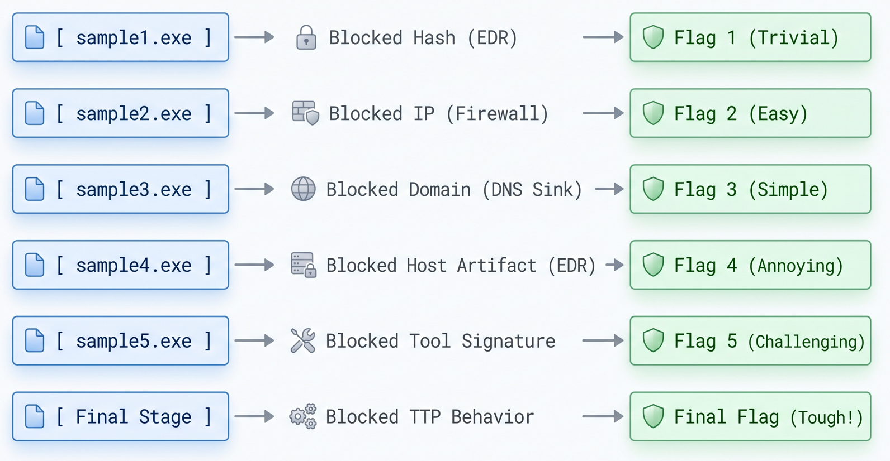

| Cycle | Pyramid Tier | Adversary Adaptation | Telemetry / Indicator Discovered | Defensive Control Enforced | MITRE ATT&CK |
| :--- | :--- | :--- | :--- | :--- | :--- |
| **1** | **Hash Values** *(Trivial)* | Executed static binary `sample1.exe` | SHA-256 (`9c550591...efca8c`) with Metasploit markers | Added SHA-256 hash to global EDR IOC blocklist | Execution (`TA0002`) |
| **2** | **IP Addresses** *(Easy)* | Recompiled `sample2.exe` to alter hash; bypassed DNS | Direct outbound HTTP GET to `154.35.10.113:4444` (`PID: 1927`) | Deployed egress `Deny` rule on perimeter firewall | Command & Control (`TA0011`) |
| **3** | **Domain Names** *(Simple)* | Migrated C2 to cloud hosting (`Xplorita Cloud Services`) | DNS queries to `emudyn.bresonicz.info` staging `backdoor.exe` | Configured DNS sinkhole policy (`Deny` + subdomains) | Command & Control (`TA0011`) |
| **4** | **Host Artifacts** *(Annoying)* | Tampered with Windows Defender via `sample4.exe` (`PID: 3806`) | Registry write: `DisableRealtimeMonitoring = 1` | Authored Sysmon Registry Sigma rule (`Event ID 13`) | Defense Evasion (`TA0005`) |
| **5** | **Tools** *(Challenging)* | Deployed C2 agent staging `beacon.bat` (`PID: 1702`) | Egress heartbeat to `51.102.10.19:443` (`97 bytes` / `1800s`) | Authored Sysmon Network Sigma rule (`Event ID 3`) | Command & Control (`TA0011`) |
| **6** | **TTPs** *(Tough)* | Abandoned custom tools for native `cmd.exe` shells (`PID: 8374`) | Parent-child spawn staging `%Temp%\exfiltr8.log` | Authored Sysmon File/Process Lineage Sigma rule (`Event ID 2`) | Exfiltration (`TA0010`) |

---

## 4. Technical Analysis & Evidence Walkthrough

### Case 1: `sample1.exe` — Hash Values *(Trivial)*
* **Initial Threat Delivery & Sandbox Triage:** Rather than executing the untrusted binary on the live workstation, I routed `sample1.exe` (`202.50 KB`) to the Malware Sandbox. Dynamic analysis identified a 64-bit Windows executable (`application/x-dosexec`) tagged as `Trojan.Metasploit.A` (`PID: 2492`) attempting outbound connections on an unusual port.
  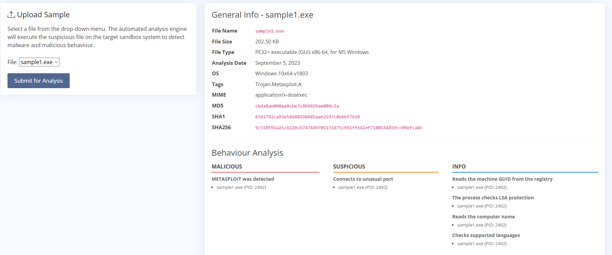
* **Enforced Containment:** Extracted the binary's SHA-256 hash (`9c550591a25c6228cb7d74d970d133d75c961ffed2ef7180144859cc09efca8c`) and deployed a cryptographic block rule in the EDR IOC Management console, preventing execution on the endpoint.
  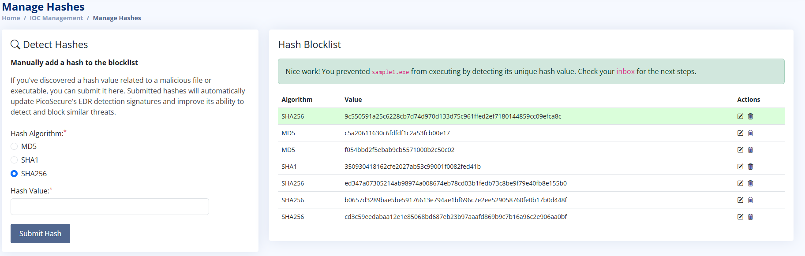

---

### Case 2: `sample2.exe` — IP Addresses *(Easy)*
* **Adversary Adaptation & Network Telemetry:** Sphinx recompiled the payload to alter its SHA-256 signature (`d576245e85e6b752b2fdf...b0169fd04924d6cebc1cdf9`), bypassing static hash checks. Sandbox network telemetry revealed `sample2.exe` (`PID: 1927`) performed zero DNS lookups and initiated a direct HTTP GET request (`http://154.35.10.113:4444/uvLk8Yl32`) to an external server hosted by Intrabuzz Hosting Limited.
  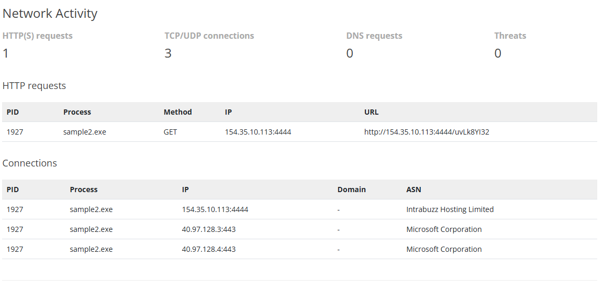
* **Enforced Containment:** Configured an outbound egress `Deny` rule on the perimeter firewall blocking all traffic from `Any` internal source to destination IP `154.35.10.113`, severing the C2 socket before establishment.
  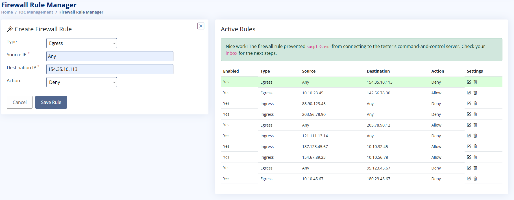

---

### Case 3: `sample3.exe` — Domain Names *(Simple)*
* **Adversary Adaptation & DNS Telemetry:** To survive static IP blocks, Sphinx migrated C2 infrastructure to cloud hosting (`Xplorita Cloud Services`) and delivered `sample3.exe` (`PID: 1021`). Sandbox inspection showed the binary querying DNS for `emudyn.bresonicz.info` (resolving to `62.123.140.9`) and issuing HTTP GET requests over ports `1337` and `80` to download a secondary payload (`backdoor.exe`, `PID: 2712`).
  
* **Enforced Containment:** Implemented an enterprise DNS sinkhole rule in the DNS Rule Manager blocking `emudyn.bresonicz.info` and all associated subdomains, halting domain resolution and second-stage payload retrieval.
  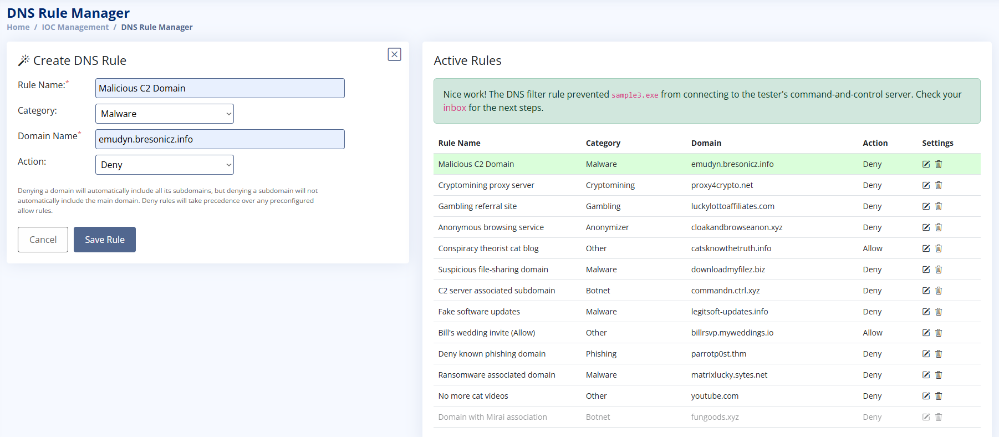

---

### Case 4: `sample4.exe` — Host & Network Artifacts *(Annoying)*
* **Adversary Adaptation & Host Telemetry:** Recognizing that perimeter blocks were neutralizing external C2 domains (`cranes0ft.iniware.xyz` resolving to `102.23.20.118`), Sphinx deployed `sample4.exe` (`PID: 3806`) to modify host security configurations directly.
  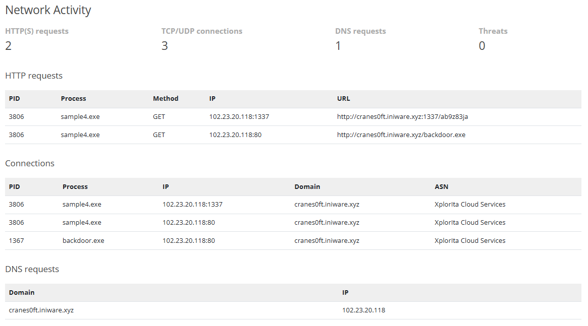
* **Registry Artifact Triangulation:** Sandbox registry telemetry revealed `sample4.exe` writing `DisableRealtimeMonitoring = 1` under `HKEY_LOCAL_MACHINE\SOFTWARE\Microsoft\Windows Defender\Real-Time Protection` to blind endpoint antivirus monitoring.
  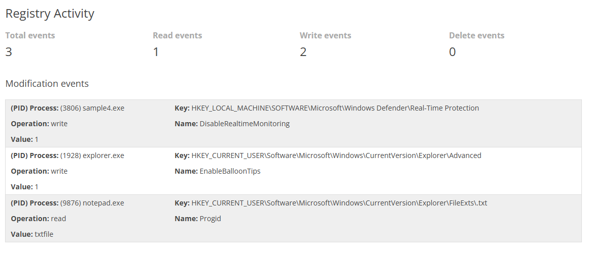
* **Enforced Containment (Sigma Rule):** Authored a behavioral Sysmon Sigma rule (`rules/win_defender_realtime_tampering.yml`) targeting unauthorized modifications to `DisableRealtimeMonitoring` mapped to **MITRE ATT&CK Defense Evasion (`TA0005`)**.
  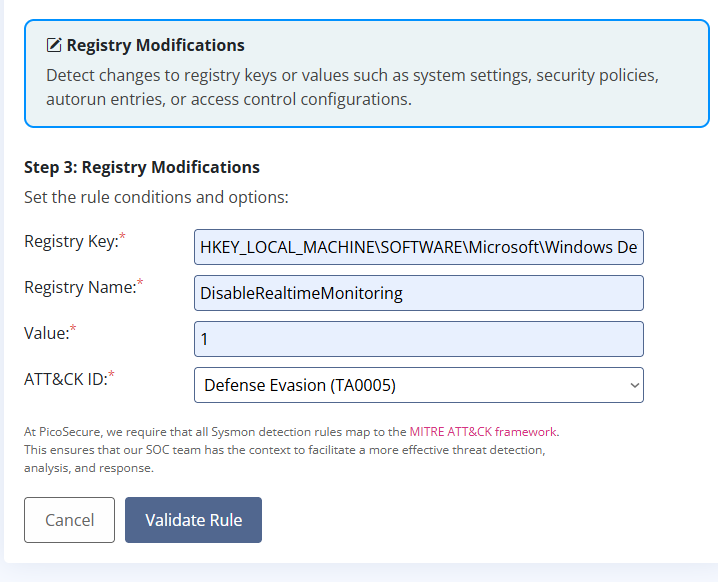

---

### Case 5: `sample5.exe` — Tools *(Challenging)*
* **Log Correlation & Beacon Profiling:** Sphinx abandoned standalone executables in favor of a modular C2 framework (`sample5.exe`, `PID: 8374`), dropping `beacon.bat` (`PID: 1702`). Correlating 12 hours of host egress telemetry (`outgoing_connections.log`) revealed automated check-ins to `51.102.10.19:443` with a fixed **97-byte** payload occurring every **1800 seconds (30 minutes)**.
  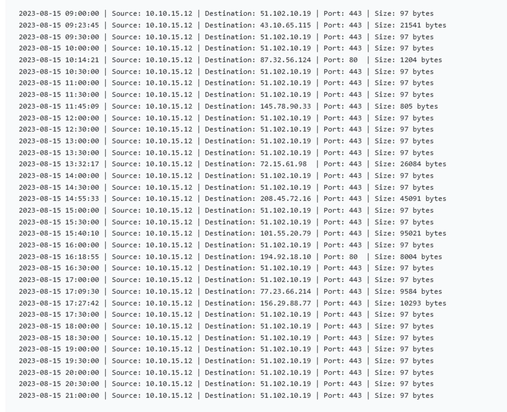
* **Sandbox Confirmation:** Sandbox network inspection confirmed `beacon.bat` issuing repetitive HTTP POST requests to `https://bababa10la.cn/keep-alive?hostname=WK102`.
  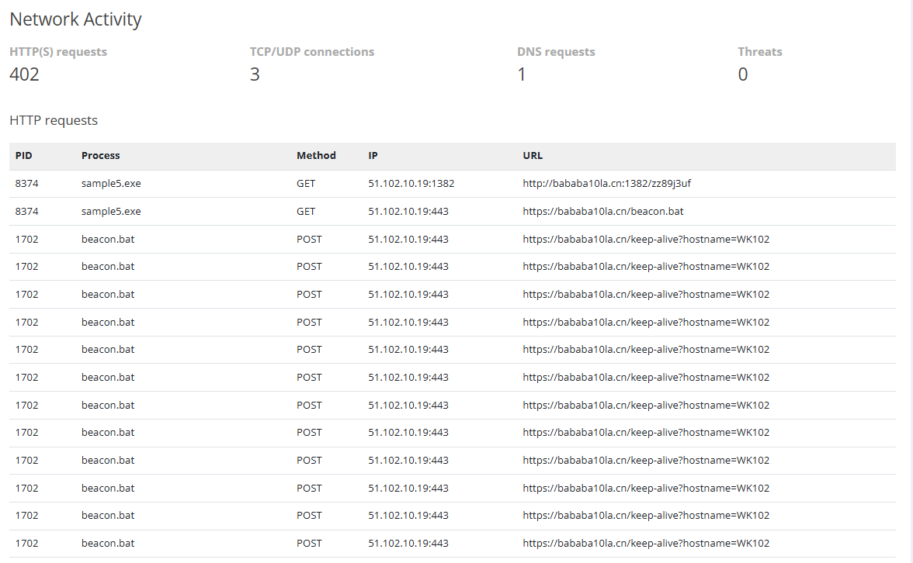
* **Enforced Containment (Sigma Rule):** Engineered a Sysmon Network Connection Sigma rule (`rules/c2_periodic_beacon_network_profile.yml`) matching the tool's 97-byte packet size and 1800-second interval, mapped to **MITRE ATT&CK Command and Control (`TA0011`)**.
  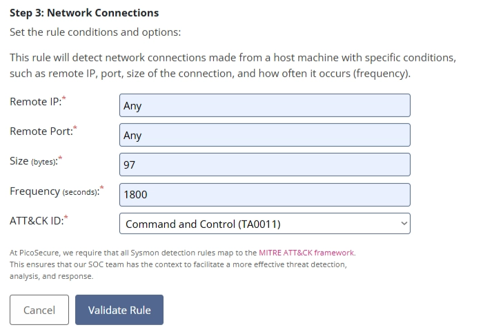

---

### Case 6: `sample6.exe` — Tactics, Techniques, and Procedures *(Tough)*
* **Living-off-the-Land (LotL) Process Lineage:** Pushed to the apex of the Pyramid of Pain, Sphinx stopped using external C2 tooling and abused native OS utilities. Sandbox process telemetry showed `sample6.exe` (`PID: 8374`) spawning multiple child `cmd.exe` shells (`PIDs: 3992, 1432, 2312`), with `PID: 2312` staging reconnaissance output into `%temp%\exfiltr8.log`.
  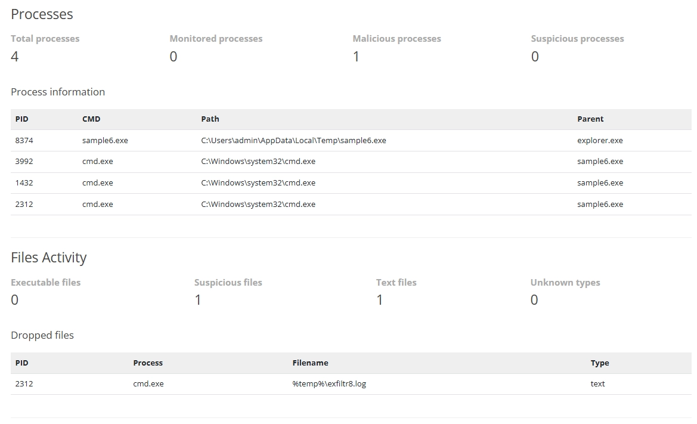
* **Enforced Containment (Sigma Rule):** Authored a Sysmon File Creation/Modification Sigma rule (`rules/lotl_cmd_temp_data_staging.yml`) detecting writes to `*\exfiltr8.log` inside `*\AppData\Local\Temp\*`, mapped to **MITRE ATT&CK Exfiltration (`TA0010`)**. Denying this ingrained TTP neutralized Sphinx's methodology and ended the intrusion.
  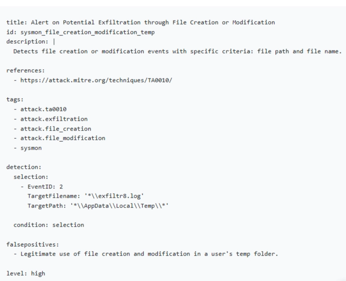

---

## 5. Root Cause Analysis & Hardening Recommendations

### Root Cause Findings
1. **Brittleness of Static Signatures:** File hashes (`sample1.exe`) and single IP blocks (`154.35.10.113`) were bypassed within minutes via source recompilation and cloud failover.
2. **Permissive User-Writable Execution Paths:** Standard users were permitted to download and execute untrusted binaries directly out of `%LocalAppData%\Temp\`.
3. **Unrestricted Defender Registry & Child Shell Execution:** Local user-context processes could modify Windows Defender registry keys and spawn unmonitored `cmd.exe` shells to stage data.

### Strategic Remediation Plan
1. **Enforce Application Control (AppLocker / WDAC):** Block execution of `.exe`, `.bat`, and script payloads originating from user-writable temporary directories (`%LocalAppData%\Temp\*`).
2. **Enable Windows Defender Tamper Protection:** Lock down Defender registry keys via Group Policy so local processes cannot write `DisableRealtimeMonitoring = 1`.
3. **Deploy Behavioral Sysmon & Sigma Pipelines:** Maintain continuous alerting on Sysmon `Event ID 1` (Process Creation), `Event ID 2` (File Creation), `Event ID 3` (Network Connection), and `Event ID 13` (Registry Value Set).
4. **Automate DNS Threat Intelligence Filtering:** Enforce DNS RPZ / threat-feed blocking to automatically sinkhole newly registered or dynamic C2 domains.

---

## 6. Repository Structure

```text
purple-team-detection-engineering-pyramid-of-pain/
├── README.md                                      # Complete Purple-Team Case Study & Report
├── rules/
│   ├── win_defender_realtime_tampering.yml        # Case 4: Sysmon Event ID 13 Sigma Rule (TA0005)
│   ├── c2_periodic_beacon_network_profile.yml     # Case 5: Sysmon Event ID 3 Sigma Rule (TA0011)
│   └── lotl_cmd_temp_data_staging.yml             # Case 6: Sysmon Event ID 2 Sigma Rule (TA0010)
├── iocs/
│   └── blocked_indicators.md                      # Extracted Hashes, C2 IPs, Domains & Host Artifacts
└── screenshots/                                   # 15 Curated Sandbox, Firewall, DNS & Sigma Captures
```
